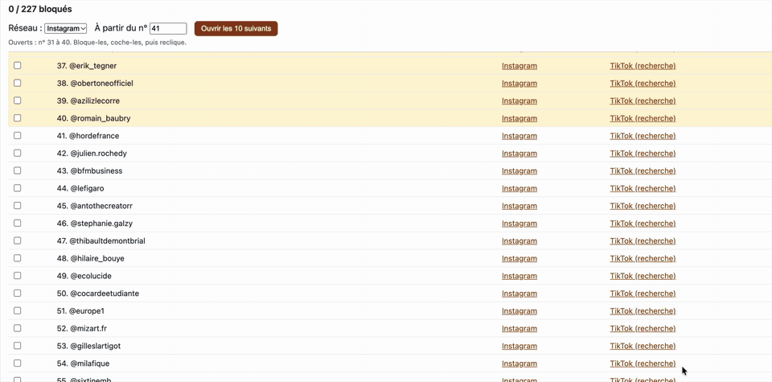
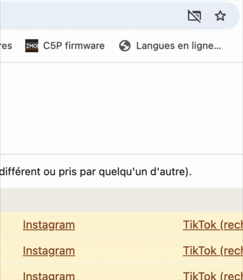

# bloquer_extrem

Un outil pour bloquer une liste de comptes Instagram par lots, sans avoir à cliquer sur « … » → « Bloquer » → « Bloquer » pour chaque compte.

Il y a deux éléments :

- **`index.html`** : la page avec la liste des comptes et un bouton qui ouvre les profils par lots (10, 20…).
- **`bloquer-instagram.user.js`** : un petit script qui fait les clics de blocage à ta place sur chaque profil ouvert depuis la liste.

---

## Vidéos de démonstration

**Comment ça marche**



**Comment autoriser les pop-ups**



> Versions en meilleure qualité : [fonction_blocage.mov](fonction_blocage.mov) · [autoriser_popups.mov](autoriser_popups.mov)

---

## Partie 1 : Mode d'emploi (aucune connaissance en code nécessaire)

Il faut un ordinateur avec **Google Chrome** (ou Edge, Brave, Firefox), et être **connecté(e) à ton compte Instagram** dans ce navigateur.

### Étape 1 : Installer Tampermonkey (une seule fois)

Tampermonkey est une extension gratuite qui permet d'ajouter des petits scripts à des sites.

1. Va sur https://www.tampermonkey.net
2. Clique sur le bouton de téléchargement correspondant à ton navigateur.
3. Sur la page de la boutique d'extensions, clique sur **« Ajouter à Chrome »**, puis **« Ajouter l'extension »**.

### Étape 2 : Autoriser les scripts (une seule fois, Chrome / Edge / Brave)

Sans ce réglage, le script ne se lance pas du tout.

1. Dans la barre d'adresse, tape `chrome://extensions` puis Entrée.
2. Active le **« Mode développeur »** (interrupteur en haut à droite).
3. Trouve Tampermonkey, clique sur **« Détails »**.
4. Active **« Autoriser les scripts utilisateur »** (si l'option existe).

### Étape 3 : Installer le script de blocage (une seule fois)

1. Ouvre ce lien : https://raw.githubusercontent.com/lefie-gravure/bloquer_extrem/main/bloquer-instagram.user.js
2. Tampermonkey ouvre une page avec un bouton **« Installer »** : clique dessus.

> Le script ne fait rien quand tu utilises Instagram normalement. Il ne s'active que sur les profils ouverts depuis la liste (leur adresse se termine par `#bloquer`).

### Étape 4 : Ouvrir la liste

- **Option simple** : ouvre https://lefie-gravure.github.io/bloquer_extrem/ (si la page n'existe pas, voir « Publier la liste en ligne » plus bas).
- **Autre option** : télécharge le fichier `index.html` de ce dépôt et double-clique dessus.

### Étape 5 : Bloquer par lots

1. Dans **« Réseau »**, laisse **Instagram**.
2. Dans **« Par lot »**, choisis combien de profils ouvrir à la fois (10 conseillé).
3. Clique sur **« Ouvrir le lot suivant »**.
4. **La première fois**, le navigateur bloque les fenêtres : clique sur l'icône qui apparaît à droite de la barre d'adresse, choisis **« Toujours autoriser les pop-ups »**, puis reclique sur le bouton. 
5. Les profils s'ouvrent dans des onglets. Sur chacun, un badge en haut à droite indique ce qui se passe :
   - **Vert « bloqué ✓ »** ou **« déjà bloqué ✓ »** : c'est fait, l'onglet se ferme tout seul.
   - **Rouge « échec, à faire à la main »** : le compte n'existe pas, a changé de nom, ou Instagram a modifié sa page. Bloque-le à la main ou passe au suivant.
6. Coche les lignes faites dans la liste, puis clique à nouveau sur **« Ouvrir le lot suivant »**. Le numéro de départ avance tout seul.

### Ajouter des comptes à la liste

**Pour un ajout rapide, juste pour toi (rien n'est enregistré)**

1. Sur la page de la liste, clique sur **« Ajouter des comptes pour cette session »**.
2. Colle les pseudos, **un par ligne** (avec ou sans @).
3. Clique sur **« Ajouter à la liste »**. Ils apparaissent en bas, dans la section « Ajoutés pendant cette session ».

Ils disparaissent quand tu fermes la page.

**Pour un ajout définitif, visible par tout le monde (directement sur GitHub, sans rien installer)**

1. Connecte-toi à GitHub et ouvre https://github.com/lefie-gravure/bloquer_extrem
2. Clique sur le fichier **`index.html`**, puis sur l'icône **crayon ✏️** (« Edit this file ») en haut à droite.
   - Si tu n'es pas propriétaire du dépôt, GitHub te propose de créer une copie (« Fork this repository ») : accepte.
3. Descends jusqu'à la ligne **`// Ajoute tes nouveaux comptes juste au-dessus de cette ligne`**.
4. Juste au-dessus, ajoute **une ligne par compte**, en respectant exactement ce format (guillemets et virgule) :
   ```
     "pseudo_du_compte",
   ```
   Pour regrouper tes ajouts sous un titre, ajoute d'abord une ligne qui commence par `#` :
   ```
     "# Ajouts novembre 2026",
     "premier_pseudo",
     "deuxieme_pseudo",
   ```
5. Clique sur **« Commit changes… »** (en haut à droite), écris un petit message (ex. « Ajout de 3 comptes »), puis valide.
   - Si tu n'es pas propriétaire, GitHub te propose ensuite **« Create pull request »** : clique dessus. La personne qui gère le dépôt verra ta proposition et pourra l'accepter.

**Bon à savoir**

- Les doublons sont ignorés automatiquement, et le @ est retiré s'il y est.
- Un pseudo mal écrit (espace, accent, caractère interdit…) s'affiche avec la mention rouge **« pseudo invalide ? »**.
- Si la liste ne s'affiche plus après ta modification, il manque probablement un guillemet ou une virgule sur une ligne ajoutée.
- **Tu ne sais pas modifier le fichier ?** Ouvre l'onglet **« Issues »** du dépôt → **« New issue »**, colle la liste des pseudos et envoie : la personne qui gère le dépôt les ajoutera.

### Conseils importants

- **Fais une pause de quelques minutes entre deux lots.** Bloquer des dizaines de comptes très vite peut entraîner une limitation temporaire de ton compte Instagram.
- Si tu fermes la liste, les cases cochées sont perdues : note le dernier numéro et remets-le dans **« À partir du n° »** pour reprendre.
- **TikTok** : les liens TikTok ouvrent une *recherche*, car les pseudos TikTok sont souvent différents. Vérifie que c'est le bon compte, puis bloque à la main (profil → flèche de partage ou « … » → « Bloquer »). Le script ne fonctionne pas sur TikTok.

### Publier la liste en ligne (pour la personne qui gère le dépôt)

Sur GitHub : **Settings** → **Pages** → dans « Branch », choisis **main** et **/ (root)** → **Save**. Après une minute, la liste est disponible à l'adresse https://lefie-gravure.github.io/bloquer_extrem/

---

## Partie 2 : Explications pour une IA (ou un développeur)

Contexte à fournir à une IA qui doit maintenir ou adapter cet outil.

### Architecture

- **`index.html`** : page statique autonome (HTML/CSS/JS inline, aucune dépendance).
  - **Données** : tableau `COMPTES` dans le premier `<script>`, entre les commentaires `LISTE DES COMPTES A BLOQUER` et `FIN DE LA LISTE`. Une chaîne par compte (pseudo Instagram sans @). Une chaîne qui commence par `#` est un titre de section. Pour ajouter des comptes, insérer des lignes `"pseudo",` avant le commentaire `// Ajoute tes nouveaux comptes…`. Ne pas modifier le reste du fichier.
  - `rendre(liste)` génère le tableau : normalisation (`trim`, retrait du `@`, des espaces, minuscules), dédoublonnage, numérotation continue, validation `^[a-z0-9._]{1,30}$` sans point final (sinon mention « pseudo invalide ? »). Chaque ligne a une case à cocher, un lien `https://www.instagram.com/<pseudo>/#bloquer` et un lien `https://www.tiktok.com/search/user?q=<pseudo>`. Les cases déjà cochées sont conservées par position.
  - `ajouter()` : ajout temporaire (en mémoire) depuis la zone de texte, sous une section « Ajoutés pendant cette session ».
  - `go()` : prend les lignes `#t tr:not(.sec)`, ouvre le lot à partir de `#start` (1-indexé) de taille `#taille` (1 à 50), sur le lien d'index `#net` (0 = Instagram, 1 = TikTok), via `window.open(href, '_blank')`, puis incrémente `#start` si tous les onglets ont été ouverts (sinon, message sur le blocage des pop-ups).
  - Aucun stockage navigateur : l'état est perdu à la fermeture.
- **`bloquer-instagram.user.js`** : userscript Tampermonkey.
  - `@match https://www.instagram.com/*`, `@run-at document-start`, `@grant window.close`.
  - Garde-fou : sort immédiatement si `location.href` ne contient pas `#bloquer` (lu à document-start, avant que la SPA ne réécrive l'URL).
  - Séquence, avec `attendre()` (polling 300 ms, timeout 15 s) et des pauses aléatoires d'environ 0,7 à 1,5 s entre les clics :
    1. Clic sur `svg[aria-label="Options"]` (priorité à celui dans `header`), via son ancêtre `[role="button"]`/`button`.
    2. Recherche d'un élément feuille (`span`, `div[role=button]`, `button` sans enfant `span`/`div`) dont le texte est exactement `Bloquer` ou `Débloquer`, hors `<button>`. Si c'est `Débloquer`, le compte est déjà bloqué : badge vert, puis `window.close()`.
    3. Sinon, clic sur `Bloquer` (élément de menu), puis sur le `<button>` de confirmation dont le texte est exactement `Bloquer`.
  - Badge fixe en haut à droite qui affiche l'étape courante (gris), le succès (vert) ou l'échec (rouge, avec l'étape où ça s'est arrêté).
  - `FERMER_ONGLET` (bool) et `DELAI_MAX` (ms) sont configurables en tête de script.

### Points fragiles et pistes de maintenance

- Les classes CSS d'Instagram (`x1lliihq`…) sont générées et changent souvent : **ne pas s'y fier**. Le script repose sur `aria-label="Options"` et sur les textes visibles **en français** (`Bloquer`, `Débloquer`). Pour un Instagram en anglais, ajouter `Block` / `Unblock`.
- `window.close()` ne fonctionne que si l'onglet a été ouvert par `window.open` (bouton de la liste). Un clic direct sur un lien ne permet pas la fermeture : le badge le signale.
- Ni l'API Instagram Graph ni l'API TikTok ne permettent de bloquer un utilisateur : d'où l'automatisation côté navigateur.
- Limitation de débit : garder des délais aléatoires et des lots courts. Ne pas paralléliser davantage.
- Pour modifier la liste, ne toucher qu'au tableau `COMPTES`. Une erreur de syntaxe JS dans ce tableau (guillemet ou virgule manquant) empêche toute la page de s'afficher.
